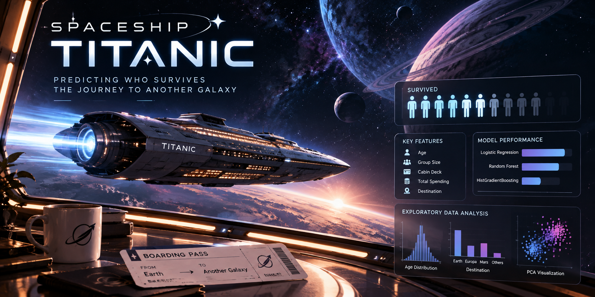
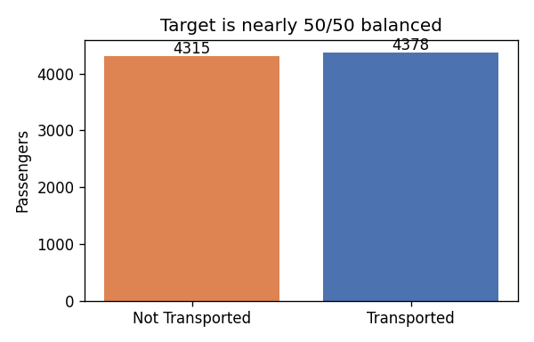
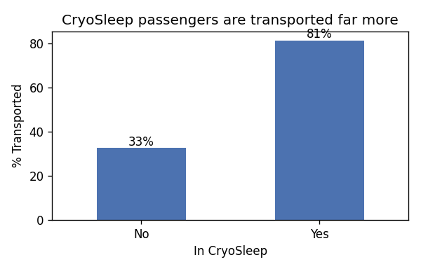
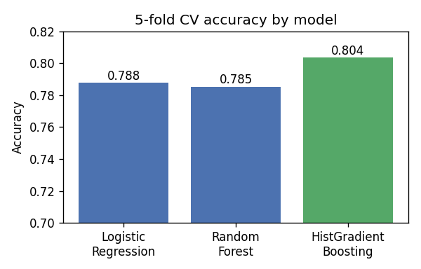
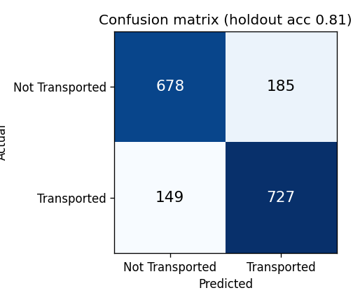
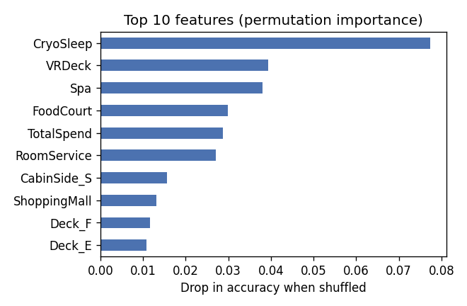

# Spaceship Titanic: Predicting Who Got Transported



This is my newbie 🍼 ML project on the [Kaggle Spaceship Titanic](https://www.kaggle.com/competitions/spaceship-titanic) dataset. The project is to predict which passengers were transported to another dimension after the ship hit a spacetime anomaly. It is a binary classification problem. I self-learn from the materials from - Kaggle courses, Google ML Crash Courses, my own custom agent from Claude to design a 30-days ML program including related YouTube videos.

### Please feel free to leave me any comments (or 📩 👉 natkuma@outlook.com) on how to improve this project, I'm super new to this topic, your advice will be VERY helpful for my learning journey!!
# 

**Best model:** HistGradientBoosting, about **82% holdout accuracy** (80.5% with 5-fold cross-validation), which is in the same range as strong public solutions for this competition. The API and app let you pick any of three models; see [The three models](#the-three-models).

The full write-up with charts and step-by-step explanation is in [`notebooks/spaceship-titanic.ipynb`](notebooks/spaceship-titanic.ipynb). A clean script version is in [`src/pipeline.py`](src/pipeline.py).

## Version history

| Version | Date | Notes |
| --- | --- | --- |
| 1.0 | 2026&#8209;09&#8209;01 | My first attempt at training a machine learning model. I used AI-generated advice extensively to help me learn the workflow and build this project. |
| 1.1 | 2026&#8209;09&#8209;06 | Added the model training and evaluation step (HistGradientBoostingClassifier), reaching ~81% validation accuracy on the cleaned dataset. |
| 1.2 | 2026&#8209;09&#8209;09 | 
| 1.3 | 2026&#8209;11&#8209;01 | Added Interface |


---

## How to run it

### 1. Clone the repo

    git clone https://github.com/Natkuma01/spaceship-titanic.git
    cd spaceship-titanic

### 2. Create a virtual environment and install dependencies

    python3 -m venv .venv
    source .venv/bin/activate        # Windows: .venv\Scripts\activate
    pip install -r requirements.txt

### 3. Download the data

The CSVs aren't in the repo because of Kaggle's rules. Download them from
https://www.kaggle.com/competitions/spaceship-titanic/data and put them in `data/`:

    data/train.csv
    data/test.csv
    data/sample_submission.csv

### 4. Train the models

`python scripts/train.py` trains all three models (Logistic Regression, Random
Forest and HistGradientBoosting), scores each one, and writes each model and its
metadata to `artifacts/`. Run it from the project root with `src` on the import
path:

    PYTHONPATH=src python scripts/train.py

It writes one model file and one metadata file per model:

    artifacts/spaceship_titanic_logistic_regression_v1.joblib
    artifacts/spaceship_titanic_logistic_regression_v1_metadata.json
    artifacts/spaceship_titanic_random_forest_v1.joblib
    artifacts/spaceship_titanic_random_forest_v1_metadata.json
    artifacts/spaceship_titanic_hist_gradient_boosting_v1.joblib
    artifacts/spaceship_titanic_hist_gradient_boosting_v1_metadata.json

Each metadata file records the model name, version, training time, decision
threshold, and its accuracy scores.

### 5. Start the API (terminal 1)

    PYTHONPATH=src uvicorn api.main:app --reload

- API: http://localhost:8000
- Interactive docs: http://localhost:8000/docs

The API loads all three models at startup.

| Endpoint | What it does |
| --- | --- |
| `GET /health` | Returns `{"status": "ok"}` |
| `GET /models` | Lists the three models: `key`, `display_name`, `description` and `metrics` |
| `GET /model-info` | Full saved metadata for every model, keyed by model name |
| `POST /predict` | Predicts one passenger |
| `POST /predict-batch` | Predicts 1 to 100 passengers in one call |

Both prediction endpoints now **require** a `model` field. It must be one of
`logistic_regression`, `random_forest` or `hist_gradient_boosting`; a missing
or unknown value is rejected with HTTP 422.

    curl -X POST http://localhost:8000/predict \
      -H "Content-Type: application/json" \
      -d '{
            "PassengerId": "0001_01",
            "HomePlanet": "Europa",
            "CryoSleep": false,
            "Cabin": "B/0/P",
            "Destination": "TRAPPIST-1e",
            "Age": 39,
            "VIP": false,
            "RoomService": 0,
            "FoodCourt": 0,
            "ShoppingMall": 0,
            "Spa": 0,
            "VRDeck": 0,
            "model": "hist_gradient_boosting"
          }'

    curl -X POST http://localhost:8000/predict-batch \
      -H "Content-Type: application/json" \
      -d '{
            "model": "random_forest",
            "passengers": [
              {"PassengerId": "0001_01", "HomePlanet": "Europa", "Age": 39},
              {"PassengerId": "0002_01", "HomePlanet": "Earth", "CryoSleep": true}
            ]
          }'

The response includes `model_name`, so you can see which model answered.

### 6. Start the Streamlit app (terminal 2)

    source .venv/bin/activate
    streamlit run app/streamlit_app.py

The app opens at http://localhost:8501. Pick a model before boarding; the app
shows its description and holdout accuracy, plus a table and bar chart comparing
all three models (from `GET /models`, or a built-in copy if the API is offline).
If the API runs somewhere other than `localhost:8000`, set its address first:

    export API_BASE_URL=http://your-api-host:8000


## The three models

| Key (`model` field) | Name | Description |
| --- | --- | --- |
| `logistic_regression` | Logistic Regression | Straightforward method to predict whether a passenger was transported |
| `random_forest` | Random Forest | Combine many decision trees, learn patterns in passenger details |
| `hist_gradient_boosting` | HistGradientBoosting | Build trees in stages, each tree learning from earlier mistakes |

Scores from `scripts/train.py` (5-fold cross-validation on the 80% training
split, then a 20% holdout the model never saw):

| Model | CV accuracy (mean ± std) | Holdout accuracy | Holdout ROC-AUC |
| --- | --- | --- | --- |
| Logistic Regression | 78.9% ± 0.4% | 79.0% | 88.2% |
| Random Forest | 80.2% ± 0.6% | 81.2% | 89.5% |
| HistGradientBoosting | **80.5% ± 0.5%** | **81.9%** | **91.2%** |

---

## The problem

Each row is a passenger. Some columns describe them (home planet, age, cabin), some describe what they did on board (how much they spent on food, spa, and so on), and one column, `Transported`, is what we want to predict. The target is almost perfectly 50/50, so plain accuracy is a fair way to score the model.



## What I did

### 1. Feature engineering

Two raw columns held more information than they looked like:

- `PassengerId` (like `0001_01`) encodes a travel **group** and a person's number within it. I pulled out the group and computed `GroupSize`, how many people travelled together.
- `Cabin` (like `B/0/P`) encodes **deck / number / side**. I split it into `Deck`, `CabinNum` and `CabinSide`.

I also added `TotalSpend`, the sum of all five spending columns.

### 2. Filling missing values with logic

About 2% of cells were missing. Instead of filling everything with a single average, I used patterns in the data:

- **CryoSleep:** passengers asleep in a pod could not spend money, so when CryoSleep was missing I inferred it from spending (spent nothing means probably asleep). This alone matches the real value about 90% of the time.
- **HomePlanet and CabinSide:** people in the same travel group share these, so I copied the value from their group-mates. I checked first that groups really do share a cabin side, and it held for 100% of groups.
- **Spending columns:** a missing charge almost certainly means no charge, so I filled with 0.
- **Everything else:** the most common value, and the median for age.

The CryoSleep pattern also turned out to be the single strongest signal for the prediction:



### 3. Comparing models

I compared three models with 5-fold cross-validation, so the score is an average over five different splits rather than one lucky split:



| Model | CV accuracy |
| --- | --- |
| Logistic Regression | 0.788 |
| Random Forest | 0.785 |
| HistGradientBoosting | **0.804** |

HistGradientBoosting (boosted trees) came out ahead, which is typical for this kind of tabular data.

## Results

On a 20% holdout set the model never trained on, it reached **81% accuracy** with errors spread fairly evenly across both classes (it is not just always guessing one answer):



Looking at which features mattered (permutation importance, meaning how much accuracy drops when a feature is shuffled), CryoSleep and the spending columns dominate. That matches what I saw during exploration, which is a good sign the model learned something real and explainable.



## Machine learning concepts shown here

- Train/validation split and 5-fold cross-validation
- Feature engineering from raw columns
- Thoughtful missing-value imputation (using data structure, not just averages)
- One-hot encoding of categorical features
- Comparing multiple models fairly
- Reading a confusion matrix and precision/recall
- Permutation importance to explain the model
- Avoiding data leakage by applying the exact same steps to train and test

## How to run it

```bash
# 1. Install the dependencies
pip install -r requirements.txt

# 2. Download the data from Kaggle and put the CSVs in data/
#    https://www.kaggle.com/competitions/spaceship-titanic/data
#    (data/ is gitignored because Kaggle asks you not to redistribute it)

# 3a. Run the script version end to end
python src/pipeline.py

# 3b. Or open the notebook to see the full walkthrough with charts
jupyter notebook notebooks/spaceship-titanic.ipynb
```

Both produce `submissions/submission.csv`, ready to upload to Kaggle.

## What I would try next

- Tune the model settings with a grid search (learning rate, tree depth, number of trees).
- Add features like spend-per-person in a group, or a simple "spent anything at all" flag.
- Try XGBoost or LightGBM, and blend a few models together.

---

# Please feel free to leave me any comment on how to improve this project, I'm super new to this topic, your advice will be very helpful for my learning journey!!
